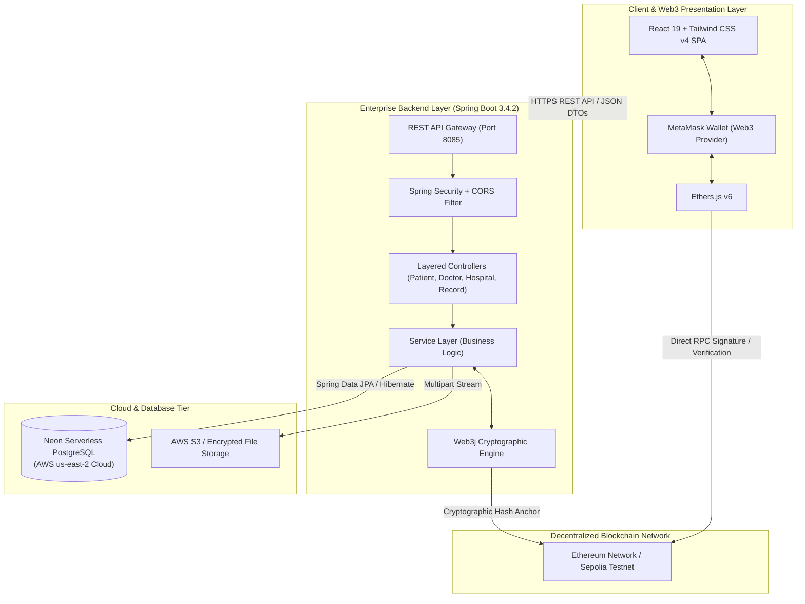
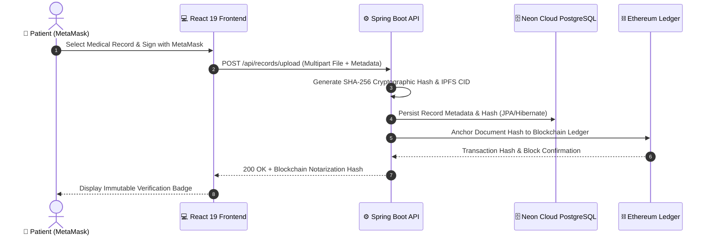
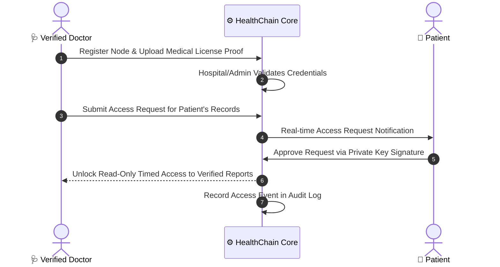

# 🏥 HealthChain: Decentralized Healthcare Network using Blockchain & Cloud Services

<p align="center">
  
  
  
  
  
  
  
  
  
</p>

---

## 📌 Executive Summary & Main Purpose

Modern Healthcare Information Systems (HIS) and Electronic Health Records (EHR) suffer from critical vulnerabilities:
1. **Centralized Silos**: Patient records are locked inside fragmented hospital databases, making seamless record transfer across clinics slow, insecure, and error-prone.
2. **Vulnerability to Ransomware & Breaches**: Centralized databases represent lucrative single-points-of-failure for malicious hackers.
3. **Lack of Patient Sovereignty**: Patients rarely have direct visibility or control over who accesses, shares, or updates their health history.
4. **Data Tampering & Integrity Risks**: Records stored in legacy SQL servers can be altered or deleted without an immutable cryptographic audit log.

### 💡 The HealthChain Solution
**HealthChain** is a next-generation decentralized healthcare infrastructure that bridges **Enterprise Java (Spring Boot 3)**, **Serverless Cloud Databases (Neon PostgreSQL)**, and **Public Blockchain (Ethereum/MetaMask)**.

By leveraging **hybrid cryptographic storage**, HealthChain ensures:
- **Patient-Centric Ownership**: Patients authenticate using their decentralized Web3 identity (MetaMask wallet) and grant granular access to medical records.
- **Cryptographic Immutability**: Every diagnostic report, prescription, and laboratory document is hashed using SHA-256 and mapped into an IPFS/Blockchain Content Identifier (CID). Any file tampering is immediately flagged by the ledger.
- **MNC-Grade Cloud Architecture**: Scalable, serverless PostgreSQL running on Neon Cloud (AWS us-east-2) ensures high availability and zero operational downtime, coupled with Spring Boot's multi-layered security.

---

## ⚖️ Traditional EHR vs. HealthChain Network

| Feature | Legacy Centralized EHR | HealthChain Decentralized Network |
| :--- | :--- | :--- |
| **Data Ownership** | Controlled by hospitals / vendors | Owned and managed directly by the Patient |
| **Authentication** | Passwords stored on central servers | Asymmetric Cryptography via MetaMask (Web3) |
| **Audit Trail** | Vulnerable database transaction logs | Immutable Distributed Ledger / Cryptographic Hashes |
| **Tamper Detection** | Weak; relies on internal database admins | Instant; SHA-256 cryptographic verification against blockchain |
| **Scalability** | Heavy monolithic database instances | Hybrid: Serverless Neon Postgres + Cloud Storage + Smart Contracts |
| **Interoperability** | Fragmented across incompatible hospital vendors | Standardized role-based protocols (Patient, Doctor, Hospital/Lab) |

---

## 🏛️ System Architecture

HealthChain adopts an enterprise-grade 4-tier hybrid architecture separating compute, persistence, cryptographic verification, and presentation:



---

## 🔄 End-to-End Workflow Flowcharts

### 1. Patient Record Upload & Blockchain Notarization


### 2. Doctor Consultation & Access Authorization Workflow


---

## 🛠️ Complete Technology Stack

### 🎨 Frontend Ecosystem
- **React.js 19.2.0**: Cutting-edge declarative UI engine with optimized concurrent rendering.
- **Tailwind CSS v4**: Ultra-fast utility-first styling with custom glassmorphism, responsive cyber grids, and atmospheric ambient glows.
- **Ethers.js 6.16.0**: Web3 client library facilitating wallet connection, JSON-RPC provider handling, and message signing.
- **MetaMask**: Non-custodial Web3 wallet enabling public-key cryptography and transaction signing.
- **Lucide React & Heroicons**: High-fidelity iconography.
- **Framer Motion**: Smooth GPU-accelerated micro-interactions.
- **Vite 7**: Blazing-fast Next-Gen build tool.

### ⚙️ Backend Architecture (MNC-Grade)
- **Java 17 / 21**: Modern LTS runtime with strict type safety.
- **Spring Boot 3.4.2**: Production-grade enterprise framework.
- **Spring Data JPA & Hibernate 6**: Resilient Object-Relational Mapping (ORM) with connection pooling.
- **Spring Security**: Robust CORS policy, role-based resource protection, and credential encryption.
- **Web3j 4.10.0**: Java implementation of Ethereum RPC protocol for transaction creation and SHA-256 / Keccak-256 cryptographic hashing.
- **Jakarta Bean Validation**: Strict payload inspection at the controller boundary.

### ☁️ Cloud & Persistence Tier
- **Neon Cloud PostgreSQL**: Serverless, high-concurrency cloud PostgreSQL database hosted on AWS us-east-2 with automatic SSL/TLS encryption.
- **AWS S3 / Cloud Storage Engine**: Secure storage for doctor credential documents and high-resolution medical imaging.
- **Web3Forms API**: Automated enterprise contact routing and incident notification service.
- **IPFS / Pinata Gateway**: Decentralized content-addressed document storage.

---

## 📂 Project Directory Structure

```plaintext
Decentralized-Healthcare-Network-using-Blockchain/
├── .env.example                               # Master environment template
├── .gitignore                                 # Production ignore rules
├── README.md                                  # Comprehensive documentation
│
├── backend/                                   # Spring Boot Enterprise Backend
│   ├── mvnw / mvnw.cmd                        # Maven wrapper binaries
│   ├── pom.xml                                # Project Object Model (Spring Boot 3.4.2)
│   └── src/
│       ├── main/
│       │   ├── java/com/backend/backend/
│       │   │   ├── BackendApplication.java    # Application entry point
│       │   │   ├── config/                    # SecurityConfig & WebConfig (CORS)
│       │   │   ├── constant/                  # System-wide AppConstants
│       │   │   ├── controller/                # REST Controllers (Patient, Doctor, Hospital, Records)
│       │   │   ├── dto/                       # Request & Response Data Transfer Objects
│       │   │   ├── entity/                    # JPA Entities (Patient, Doctor, Hospital, MedicalRecord)
│       │   │   ├── exception/                 # GlobalExceptionHandler & Custom Exceptions
│       │   │   ├── repository/                # Spring Data JPA Repositories
│       │   │   ├── service/                   # Service interfaces & Business Implementations
│       │   │   └── util/                      # Cryptographic utilities & Hash generators
│       │   └── resources/
│       │       └── application.properties     # Neon Postgres, HikariCP, & Port settings
│       └── test/                              # Automated Unit and Integration Tests
│
└── frontend/                                  # React 19 + Tailwind CSS v4 Frontend
    ├── index.html                             # Single Page Application root HTML
    ├── package.json                           # Dependencies & Vite scripts
    ├── vite.config.js                         # Vite build pipeline & proxy settings
    └── src/
        ├── App.jsx                            # Client-side router configuration
        ├── main.jsx                           # React DOM mount point
        ├── index.css                          # Tailwind v4 theme, fonts & cyber styles
        ├── components/
        │   ├── Navbar.jsx                     # Floating glassmorphic navigation
        │   ├── Home.jsx                       # Hero section & workflow visualizer
        │   └── auth/                          # Reusable InputField & FileUpload components
        ├── config/
        │   └── api.js                         # Centralized API and Web3 environment loader
        └── pages/
            ├── Landing.jsx                    # 3D Radiant Role Selector
            ├── Records.jsx                    # Ledger Explorer & Hash Verifier
            ├── Doctors.jsx                    # Verified Medical Specialists Directory
            ├── Features.jsx                   # Network Capabilities & Specifications
            ├── contact.jsx                    # Enterprise Support & Web3Forms integration
            ├── auth/                          # PatientAuth, DoctorAuth, HospitalAuth
            └── dashboards/                    # Patient, Doctor, and Hospital Dashboards
```

---

## 🌐 REST API Specification

### 👤 Patient Endpoints (`/api/patients`)
| Method | Endpoint | Description | Payload / Params |
| :--- | :--- | :--- | :--- |
| `POST` | `/api/patients/signup` | Register a new patient node | `PatientSignupRequest` JSON |
| `POST` | `/api/patients/login` | Authenticate patient credentials | `PatientLoginRequest` JSON |

### 🩺 Doctor Endpoints (`/api/doctors`)
| Method | Endpoint | Description | Payload / Params |
| :--- | :--- | :--- | :--- |
| `POST` | `/api/doctors/signup` | Register doctor & upload medical license | `MultipartFormData` (Name, Email, Specialization, File) |
| `POST` | `/api/doctors/login` | Authenticate doctor node | `DoctorLoginRequest` JSON |
| `GET` | `/api/doctors/all` | Retrieve directory of verified doctors | None |

### 🏥 Hospital & Diagnostic Lab Endpoints (`/api/hospitals`)
| Method | Endpoint | Description | Payload / Params |
| :--- | :--- | :--- | :--- |
| `POST` | `/api/hospitals/signup` | Register accredited hospital node | `HospitalSignupRequest` JSON |
| `POST` | `/api/hospitals/login` | Authenticate hospital staff | `HospitalLoginRequest` JSON |

### 📑 Medical Records & Ledger Endpoints (`/api/records`)
| Method | Endpoint | Description | Payload / Params |
| :--- | :--- | :--- | :--- |
| `GET` | `/api/records/{email}` | Retrieve patient's medical records | `email` (path variable) |
| `POST` | `/api/records/upload` | Upload & notarize medical record | `title`, `email`, `file` (multipart) |
| `DELETE` | `/api/records/{id}` | Delete local record reference | `id` (path variable) |

### 💓 System Health
| Method | Endpoint | Description | Payload / Params |
| :--- | :--- | :--- | :--- |
| `GET` | `/api/health` | Service uptime and database status | Returns status string |

---

## 🚀 Getting Started & Installation

### Prerequisites
- **Node.js**: `v18.0.0` or higher ([Download](https://nodejs.org/))
- **Java Development Kit (JDK)**: `JDK 17` or `JDK 21` ([Microsoft OpenJDK](https://learn.microsoft.com/en-us/java/openjdk/download) / Oracle)
- **MetaMask Browser Extension**: ([Install MetaMask](https://metamask.io/))
- **Git**: Installed and available in PATH.

---

### Step 1: Clone the Repository
```bash
git clone https://github.com/adityavijapure/Decentralized-Healthcare-Network-using-Blockchain.git
cd Decentralized-Healthcare-Network-using-Blockchain
```

---

### Step 2: Configure Environment Variables
Copy `.env.example` to create your active `.env` file:
```bash
cp .env.example .env
```
Ensure your database credentials and blockchain RPC URL are configured:
```env
# Spring Boot Datasource (Neon Cloud or Localhost)
SPRING_DATASOURCE_URL=jdbc:postgresql://ep-calm-queen-b4e3zwue-pooler.c-6.us-east-2.aws.neon.tech/neondb?sslmode=require
SPRING_DATASOURCE_USERNAME=neondb_owner
SPRING_DATASOURCE_PASSWORD=your_neon_password
SERVER_PORT=8085

# Frontend
VITE_API_BASE_URL=http://localhost:8085
VITE_BLOCKCHAIN_RPC_URL=http://127.0.0.1:8545
```

---

### Step 3: Launch the Enterprise Backend (Spring Boot)
Open a terminal in the `backend/` directory:
```bash
cd backend

# Compile and start the Spring Boot application
./mvnw clean spring-boot:run
```
*The Spring Boot server will initialize on port **8085** and auto-connect to the Neon PostgreSQL cloud cluster.*

---

### Step 4: Launch the Modern Frontend (React 19)
Open a second terminal in the `frontend/` directory:
```bash
cd frontend

# Install dependencies
npm install

# Start the Vite development server
npm run dev
```
Open your browser and navigate to: **`http://localhost:5173`**

---

### Step 5: Connect MetaMask Wallet
1. Open the MetaMask extension in Chrome/Edge/Firefox.
2. Select your preferred test network (e.g., **Sepolia Testnet** or a local **Hardhat/Anvil node** on port `8545`).
3. Click **"Connect MetaMask"** on the HealthChain navigation bar.
4. Your Ethereum address will automatically bind as your decentralized identity.

---

## 🔐 Security & Compliance Architecture

- **Zero-Knowledge Hash Verification**: No raw patient record is exposed directly to the public blockchain ledger; only immutable SHA-256 cryptographic hashes and IPFS CIDs are anchored.
- **Transport Layer Security (TLS 1.3)**: Enforced across all Neon PostgreSQL database connections and frontend-to-backend REST API calls.
- **Asymmetric Key Signatures**: Doctor and hospital identity attestations are backed by cryptographic public-private keypairs.
- **Role-Based Access Control (RBAC)**: Strict segregation of duties ensuring doctors only view records authorized directly by the respective patient.

---

## 👨‍💻 Author & Maintainer

**Aditya Vijapure**  
- **GitHub**: [@adityavijapure](https://github.com/adityavijapure)  
- **Email**: [adityavijapure0508@gmail.com](mailto:adityavijapure0508@gmail.com)  
- **Project**: *Decentralized Healthcare Network using Blockchain*

---

## 📄 License

This project is licensed under the **MIT License** — feel free to explore, fork, and contribute!
